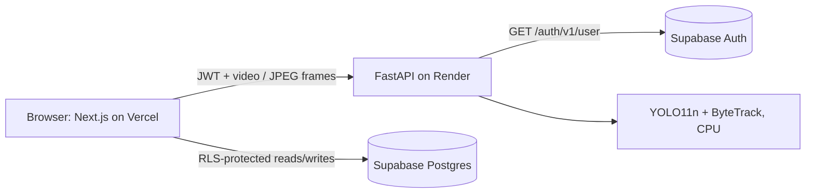

# Sentinel Vision

CPU-first video intelligence: upload a short clip or use your webcam, detect and track objects with
YOLO11 + ByteTrack, and turn sustained detections into reviewable incidents with an audit trail.

**Stack:** Next.js 14 · TypeScript · Supabase (Auth, Postgres, Row Level Security) · FastAPI · Ultralytics YOLO11n · OpenCV

## Features
- **Live operations:** webcam frames are tracked on the API (YOLO11 + ByteTrack) and drawn with motion trails. You can
  **draw zones and counting lines directly on the video**, count objects inside each zone and crossings in each
  direction, watch a live **occupancy heatmap**, and set **alert rules** (crowding, loitering, line crossing) that raise
  alerts in the event feed, with an optional sound.
- **Analysis studio:** upload a short clip and get a report plus a **heatmap**, **trajectory map**, a scrubbable
  **replay** built from the saved detections, and **per-zone statistics** (objects entered, peak occupancy, dwell time,
  line crossings, event timeline). The same zones and lines apply to every analysis.
- **Sentinel AI Investigator:** every analysis gets a plain-language summary, a scene estimate, an event timeline with
  evidence (annotated keyframes or boxes rebuilt from saved detections), per-object profiles (colour, direction, speed,
  activity), and **Ask Sentinel**: questions such as "How many people were there?", "Did anyone leave an object behind?"
  or "Describe the events between 00:15 and 00:30". A built-in analyst answers common questions with no setup; with a free
  Groq key on the API, an LLM answers free-form questions from the event text (never the video). The same works for the
  live session. Reports can be exported as Markdown or JSON, with the model and settings used (reproducibility).
- **Behaviour alerts:** running, possible falls, objects left behind or removed, and sudden crowd changes, live and in
  clips. Each alert says why it fired; alerts can be dismissed, switched off or tuned.
- **Overview:** KPI cards, detections per analysis, incident status, platform status and recent activity.
- **Incident workflow:** a class present in at least half of the analysed frames opens a "sustained detection"
  incident (duplicates suppressed for 24 h), and behaviour alerts in a clip open incidents with their evidence (time,
  track, reason and keyframe). Incidents can be acknowledged, resolved or marked as a false alarm with a note, with an
  append-only audit history written by a database trigger.
- **Search and retention:** search saved analyses by what is in them ("person in red", "bag left behind"), delete an
  analysis, or delete everything older than N days.
- **Security model:** the API verifies every request's Supabase token server-side; all tables use RLS so users
  only see their own jobs, detections and incidents.

## Architecture

Vercel hosts only the frontend. The detector needs a long-running Python process with PyTorch, which does not
fit Vercel's serverless functions, so the API runs separately (Render free tier, or any container host).

## Repository layout
```
sentinel-vision/
├── README.md                  this file
├── render.yaml                Render blueprint for the API
├── .gitignore
├── apps/
│   └── web/                   Next.js frontend (deployed on Vercel)
│       ├── app/               page, layout and global styles
│       ├── components/        overview, live stage, zones and rules, analysis views, charts
│       ├── lib/               analytics engine (zones, lines, rules, heatmaps), behaviour engine and AI investigator, React hook
│       └── tests/             analytics and investigator tests
├── services/
│   └── api/                   FastAPI inference service (deployed on Render with Docker)
│       ├── app/               API, detector, schemas
│       ├── tests/
│       ├── Dockerfile
│       └── yolo11n.pt         detector weights
├── supabase/
│   └── migrations/            SQL migrations 001-008, applied in order
└── docs/
    ├── DEPLOYMENT.md          step-by-step deployment guide
    ├── PORTFOLIO_SNIPPET.md   text for a portfolio entry
    ├── TESTING.md             manual test checklist
    └── patch-notes/           history of earlier feature notes
```

## Run locally (Windows, Anaconda)
```
conda create -n sentinel-vision python=3.11 -y
conda activate sentinel-vision
cd services\api
copy .env.example .env          # fill in SUPABASE_URL and SUPABASE_PUBLISHABLE_KEY
pip install -r requirements.txt -r requirements-dev.txt
pytest -q
python -m uvicorn app.main:app --reload --port 8000
```
In a second terminal:
```
cd apps\web
copy .env.example .env.local    # fill in the three values
npm install
npm run dev                     # http://localhost:3000
```
Database: run `supabase/migrations/001` through `008` in the Supabase SQL editor, in order. The app keeps working
without 008, but evidence on incidents, false alarms, content search and deleting analyses need it.

## Configuration
| API variable | Purpose | Default |
|---|---|---|
| `SUPABASE_URL`, `SUPABASE_PUBLISHABLE_KEY` | verify sign-in tokens (required) | none |
| `ALLOWED_ORIGINS` | exact frontend origins, comma-separated | `http://localhost:3000` |
| `ALLOWED_ORIGIN_REGEX` | optional, for Vercel preview URLs | empty |
| `MODEL_NAME` | YOLO weights file | `yolo11n.pt` |
| `MAX_UPLOAD_MB`, `MAX_VIDEO_SECONDS` | upload limits | 20, 30 |
| `FRAME_STRIDE`, `MAX_ANALYSIS_FRAMES` | sampling | 3, 300 |
| `CONFIDENCE_THRESHOLD`, `IOU_THRESHOLD`, `INFERENCE_IMAGE_SIZE` | detector calibration | 0.35, 0.45, 416 |
| `MAX_KEYFRAMES` | evidence keyframes per clip (0 = off) | 8 |
| `GROQ_API_KEY` (or `LLM_API_KEY` + `LLM_BASE_URL`) | optional AI analyst; any OpenAI-compatible chat API | empty (built-in analyst) |
| `LLM_MODEL`, `ASK_PER_MINUTE` | AI model and per-user question limit | `llama-3.1-8b-instant`, 12 |

| Web variable | Purpose |
|---|---|
| `NEXT_PUBLIC_API_BASE_URL` | URL of the deployed API |
| `NEXT_PUBLIC_SUPABASE_URL`, `NEXT_PUBLIC_SUPABASE_PUBLISHABLE_KEY` | Supabase project (the publishable key is public by design; RLS protects the data) |

## API
| Endpoint | Auth | Description |
|---|---|---|
| `GET /health` | no | liveness probe |
| `GET /ready` | no | readiness: detector state, whether the AI analyst is configured, and the run settings |
| `POST /api/v1/analyze` | Bearer token | analyse an uploaded clip (mp4, mov, avi, mkv, webm) |
| `POST /api/v1/live/frame` | Bearer token | analyse one webcam JPEG (`session_id` form field) |
| `POST /api/v1/ask` | Bearer token | answer a question or write a summary from an analysis' event text (JSON `question`, `context`, `mode`) |

Inference runs in worker threads behind a single lock (the model and tracker are shared). A second upload while
one is running gets `429`; live frames wait briefly and then get `503`.

## Known limitations
- Detections are produced by a general-purpose COCO model; there is no custom training or validation set yet,
  so no accuracy claims are made. The README in `docs/patch-notes` describes how to compare settings fairly.
- Incidents and behaviour alerts are transparent heuristics on boxes (class present in >= 50% of sampled frames; box
  speed, shape and stillness), not event understanding. Colours are the main colour of a box and change with lighting.
- Behaviour, timeline, summary and the built-in analyst run in the browser on the detections the API returns, so they add
  no load to the API. The AI analyst sends only the event text to the LLM provider you configure.
- Not included because they need a GPU or more memory than the free tier has: learned activity recognition,
  vision-language models on frames, embedding-based video search, and multiple simultaneous cameras.
- The browser saves detections and incidents to Supabase (protected by RLS). The API does not write records,
  so stored detections are as trustworthy as the signed-in user; the status-history audit table is trigger-written.
- One shared tracker means one analysis or live session is processed at a time per API instance.
- On the free Render tier the CPU is throttled and the service sleeps when idle: expect a slow first request
  and slow analysis. See `docs/DEPLOYMENT.md` for tuning and alternatives.

## Tests
- `services/api`: `pytest -q` (health, auth, upload validation, busy lock, live-frame guards, CORS).
- `apps/web`: `npm test` runs the analytics engine tests (geometry, zones, dwell time, line crossings, rules, heatmaps)
  and the investigator tests (behaviour alerts, timeline, summary, questions, search, report) in Node 22+; `npx tsc --noEmit` and `npm run lint` check types and style.

## How zones and counting work
Zones and lines are stored as fractions of the frame, so one setup works at any resolution. An object counts as inside a
zone when the bottom-centre of its box (where it touches the ground) is inside the polygon. Crossings are detected from the
movement of that point between frames, so they need a tracked object (a track ID). Dwell time counts only the time an
object was actually seen inside. The video size comes from the API for new analyses; older saved analyses fall back to an
estimate from the detections. Setup is kept in this browser (localStorage), not in the database.
