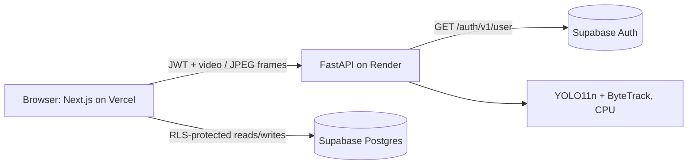

# Sentinel Vision

CPU-first video intelligence: upload a short clip or use your webcam, detect and track objects with
YOLO11 + ByteTrack, and turn sustained detections into reviewable incidents with an audit trail.

**Stack:** Next.js 14 · TypeScript · Supabase (Auth, Postgres, Row Level Security) · FastAPI · Ultralytics YOLO11n · OpenCV

## Features
- **Uploaded-video analysis:** sampled-frame detection with persistent track IDs, per-class confidence and
  frame-coverage diagnostics, annotated preview, and a detection timeline.
- **Live webcam tracking:** the browser sends sequential JPEG frames (one in flight at a time) and gets back
  annotated frames, track labels and a live event feed. Connection errors back off and recover automatically.
- **Incident workflow:** a class present in at least half of the analysed frames opens a "sustained detection"
  incident (duplicates suppressed for 24 h); incidents can be acknowledged or resolved.
- **Audit history:** every status change is recorded by a database trigger in an append-only table that
  clients can read but not write.
- **Security model:** the API verifies every request's Supabase token server-side; all tables use RLS so users
  only see their own jobs, detections and incidents.

## Architecture

Vercel hosts only the frontend. The detector needs a long-running Python process with PyTorch, which does not
fit Vercel's serverless functions, so the API runs separately (Render free tier, or any container host).

## Repository layout
    apps/web/            Next.js frontend
    services/api/        FastAPI service (inference, auth verification) + tests
    supabase/migrations/ SQL migrations 001-007 (apply in order)
    docs/                Deployment guide, portfolio snippet, historical patch notes
    render.yaml          Render blueprint for the API

## Run locally (Windows, Anaconda)
```
conda create -n sentinel-vision python=3.11 -y
conda activate sentinel-vision
cd services\api
copy .env.example .env          # fill in SUPABASE_URL and SUPABASE_PUBLISHABLE_KEY
pip install -r requirements.txt -r requirements-dev.txt
pytest -q
python -m uvicorn app.main:app --reload --port 8000
```
In a second terminal:
```
cd apps\web
copy .env.example .env.local    # fill in the three values
npm install
npm run dev                     # http://localhost:3000
```
Database: run `supabase/migrations/001` through `007` in the Supabase SQL editor, in order.

## Configuration
| API variable | Purpose | Default |
|---|---|---|
| `SUPABASE_URL`, `SUPABASE_PUBLISHABLE_KEY` | verify sign-in tokens (required) | none |
| `ALLOWED_ORIGINS` | exact frontend origins, comma-separated | `http://localhost:3000` |
| `ALLOWED_ORIGIN_REGEX` | optional, for Vercel preview URLs | empty |
| `MODEL_NAME` | YOLO weights file | `yolo11n.pt` |
| `MAX_UPLOAD_MB`, `MAX_VIDEO_SECONDS` | upload limits | 20, 30 |
| `FRAME_STRIDE`, `MAX_ANALYSIS_FRAMES` | sampling | 3, 300 |
| `CONFIDENCE_THRESHOLD`, `IOU_THRESHOLD`, `INFERENCE_IMAGE_SIZE` | detector calibration | 0.35, 0.45, 416 |

| Web variable | Purpose |
|---|---|
| `NEXT_PUBLIC_API_BASE_URL` | URL of the deployed API |
| `NEXT_PUBLIC_SUPABASE_URL`, `NEXT_PUBLIC_SUPABASE_PUBLISHABLE_KEY` | Supabase project (the publishable key is public by design; RLS protects the data) |

## API
| Endpoint | Auth | Description |
|---|---|---|
| `GET /health` | no | liveness probe |
| `GET /ready` | no | readiness; reports whether the detector is loaded (it loads on first use) |
| `POST /api/v1/analyze` | Bearer token | analyse an uploaded clip (mp4, mov, avi, mkv, webm) |
| `POST /api/v1/live/frame` | Bearer token | analyse one webcam JPEG (`session_id` form field) |

Inference runs in worker threads behind a single lock (the model and tracker are shared). A second upload while
one is running gets `429`; live frames wait briefly and then get `503`.

## Known limitations
- Detections are produced by a general-purpose COCO model; there is no custom training or validation set yet,
  so no accuracy claims are made. The README in `docs/patch-notes` describes how to compare settings fairly.
- Incidents are a transparent heuristic (class present in >= 50% of sampled frames), not event understanding.
- The browser saves detections and incidents to Supabase (protected by RLS). The API does not write records,
  so stored detections are as trustworthy as the signed-in user; the status-history audit table is trigger-written.
- One shared tracker means one analysis or live session is processed at a time per API instance.
- On the free Render tier the CPU is throttled and the service sleeps when idle: expect a slow first request
  and slow analysis. See `docs/DEPLOYMENT.md` for tuning and alternatives.

## Tests
`services/api`: `pytest -q` (health, auth, upload validation, busy lock, live-frame guards, CORS).
`apps/web`: `npx tsc --noEmit` and `npm run lint`.
